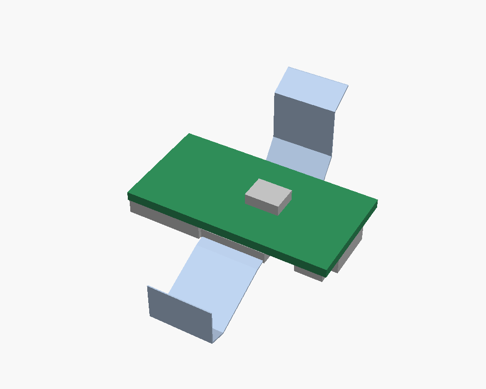
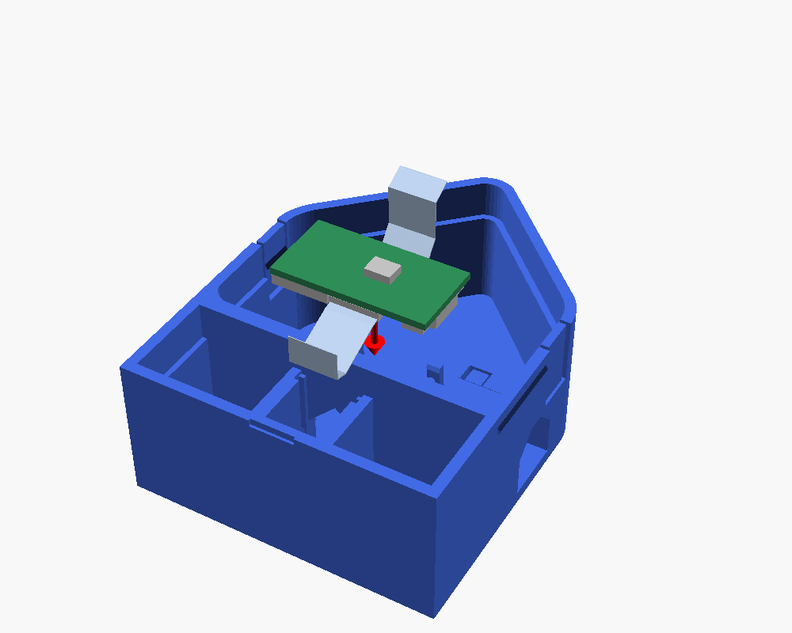
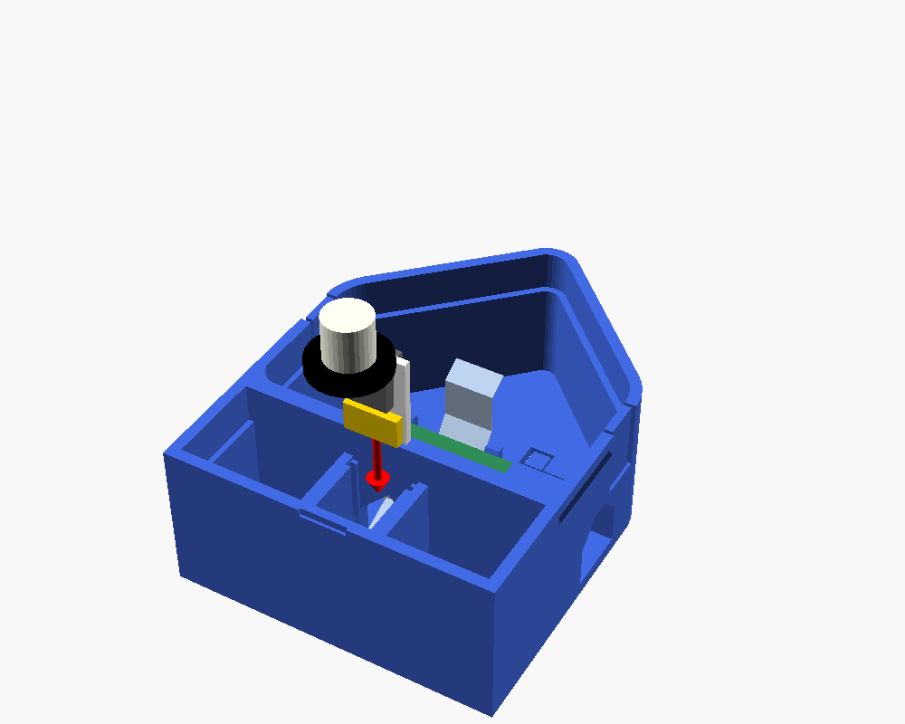
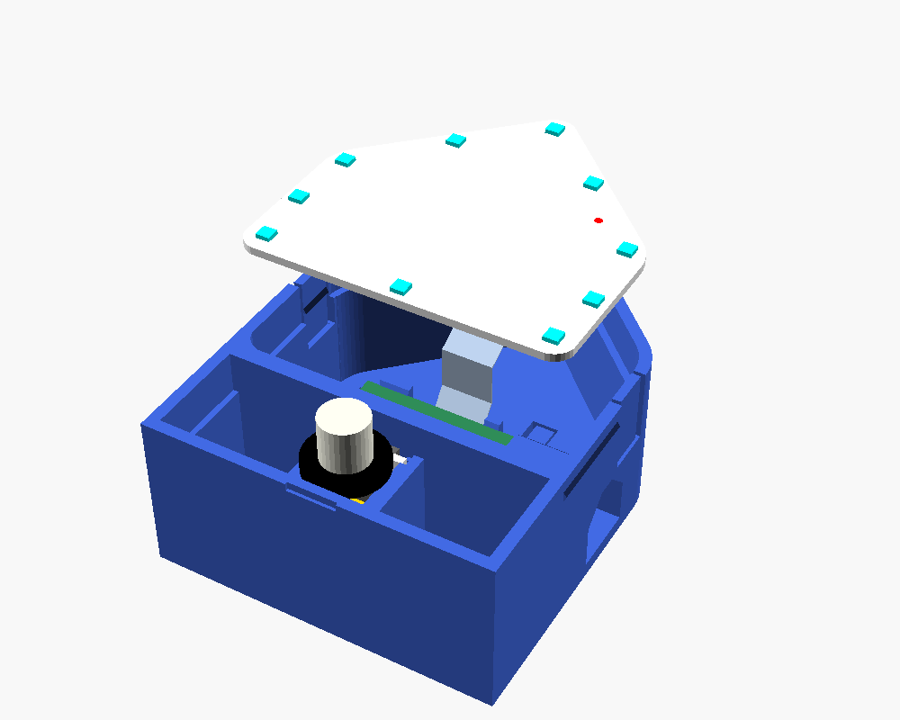
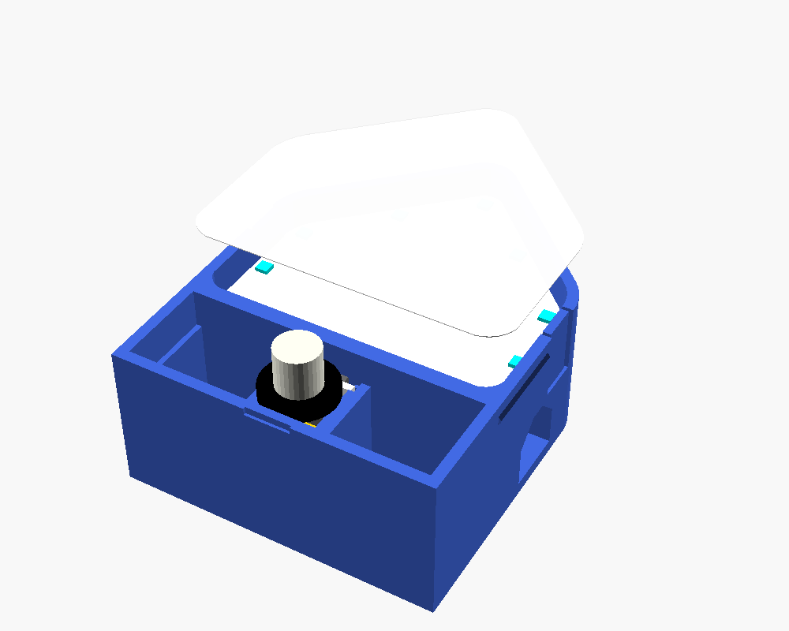
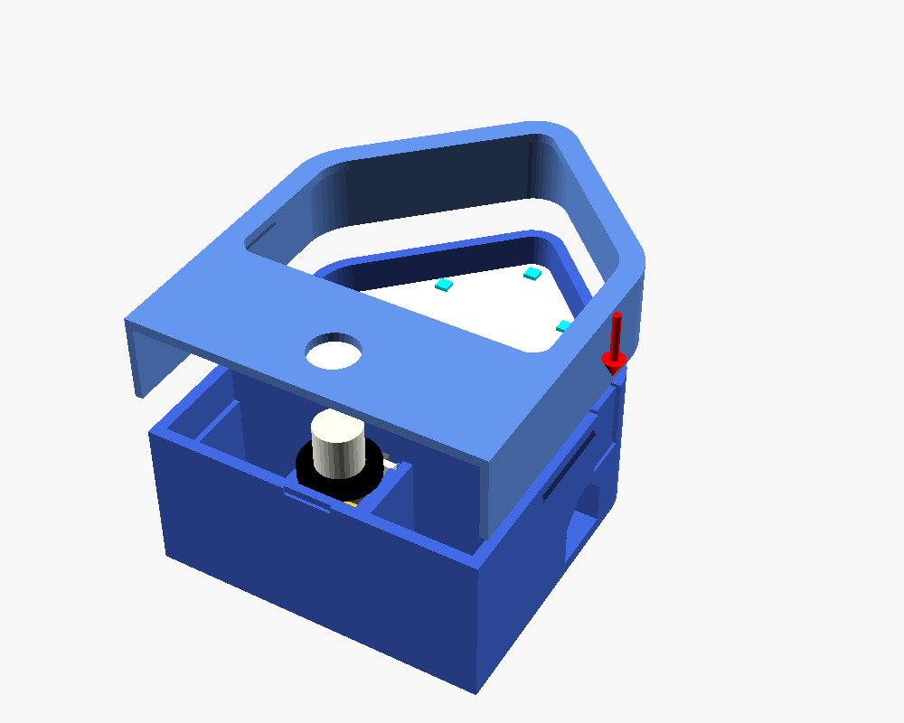

# Assembly

No screws or glue: everything clicks in. Allow 15 minutes.

## You need

- Printed `body.stl` and `frame.stl` (see the header of `enclosure.scad`)
- The ESPHome Starter Kit's C6 board, LED module and motion (PIR) module
- Two ribbon cables, about 40 mm
- A sheet of plain printer paper and scissors
- A USB-C cable, already flashed firmware (see the README)
- A craft knife, for cleaning up the print

## Before you start

1. **Clean the print.** PETG leaves strings across gaps. Cut them out of:
   - the USB opening in the right-hand side wall
   - the two slits beside each LED clip, in the side walls, so each clip strip flexes freely
   - the U-shaped slot around the boot tab in the back wall
2. **Cut the diffuser.** Lay the frame face down on the paper, trace the inside of its window, and
   cut about 3 mm outside the line. Trim the bottom edge straight, so the paper stops above the round
   hole for the motion sensor.

Lay the body **on its back**, front opening facing up. Every step below goes in from above.

## 1. Plug both ribbons into the C6

Plug a ribbon into each of the C6's two ribbon connectors, with the blue stiffener facing away from
the board. Do it now: once the C6 is in, its connectors face the back wall and you can't reach them.

## 2. Clip the C6 onto the back wall

- Turn the C6 **components down**, towards the back wall.
- USB socket towards the opening in the **right-hand** wall (right as you'll see the house from the
  front), so the BOOT button sits over the tab in the back wall.
- The ribbon on the BOOT side heads up towards the house; the other one heads down into the base.
- Tilt it with the USB end low, about 25 degrees, and slide that end under the two ledges beside
  the USB opening.
- Then press the far end down until the two hooks click over its edges. It rests on three small pads.
- To take it out, push the two far hooks outwards and lift the far end first.

## 3. Fit the motion sensor

- If you took the dome off its 3-pin header, put it back with its OUT pin in the hole the white
  board marks **Out**. Turned round, it gets its power backwards and never sees motion.
- Plug the lower ribbon into the sensor's connector.
- Turn the sensor **connector down**: the dome then hangs below the white board.
- Slide it into the channel in the base, ribbon end first, under the small lips, until it stops.
  The ribbon folds down through the arched opening behind it.

## 4. Fit the LED board

- Plug the upper ribbon into the connector on the back of the LED board. The connector opens
  towards the board's flat bottom edge.
- Lay the board in its pocket, **LEDs up**, flat edge towards the base, and press until both side
  clips click over it.

## 5. Lay the paper on

Lay the paper over the opening, on the rim around the LED board. The frame holds it.

## 6. Snap the frame on

Line the round hole up with the sensor's dome and press the frame straight down until both sides
click.

## Check it

Stand it up and plug USB-C into the side. The lights fade in when you move, and the BOOT tab
on the back changes the show (hold it for a second to turn the lights off). Pinch the house between
thumb and fingers to press it, or it tips over.

## Opening it

Put a fingernail in the notch under the front edge and lift the frame off. Push the LED clips
outwards to free the LED board.

## If something doesn't fit

The knobs at the top of `enclosure.scad` adjust each fit: `tol` (board pockets), `c6_lip` and
`led_lip` (clip grip), `snap` (frame), `boot_gap` (boot tab), `pir_play` (motion sensor) and
`dome_y` (dome hole height). Regenerate the STLs after changing one.
